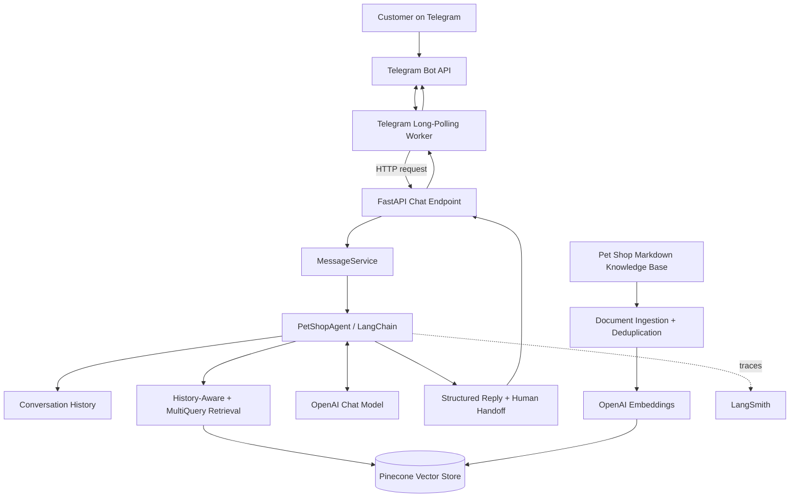

# PetStop — RAG-Powered AI Customer Support Assistant

**A portfolio project focused on applied AI engineering, retrieval-augmented generation, agent evaluation, and real-world messaging integration.**

PetStop is an AI customer support assistant for a **fictional pet shop**. It answers questions about services, grooming prices, operating hours, appointment policies, and after-grooming care using an internal knowledge base. The assistant maintains conversational context, distinguishes documented information from missing information, and signals when a request requires follow-up by a human staff member.

The application is built with **Python, FastAPI, LangChain, Pinecone, OpenAI models, and LangSmith**. A working **Telegram bot** provides a real messaging interface through long polling. This project is intended to demonstrate the design, implementation, and evaluation of an AI-enabled backend—not to represent a commercial deployment serving actual pet shop customers.

## Highlights

- **Grounded answers with RAG:** document ingestion, chunking, OpenAI embeddings, and vector similarity search.
- **Advanced retrieval:** history-aware question rewriting and a `MultiQueryRetriever` to generate alternate retrieval queries.
- **Conversation awareness:** customer-specific history enables follow-up questions and contextual references.
- **Structured responses:** the agent returns a reply, confidence level, source references, and a `needs_human_review` decision.
- **Human handoff policy:** requests that require operational action by staff are explicitly flagged; the agent does not invent bookings, inventory availability, or unverified prices.
- **Observability:** LangSmith tracing helps inspect chain execution, retrieval, prompts, and model behavior.
- **Evaluation suite:** a 30-case golden dataset, retrieval Source Recall, human-handoff classification, and LLM-as-a-Judge answer correctness.
- **Messaging integration:** Telegram Bot API integration with a FastAPI backend, tested manually in real conversations.

## Architecture



> **Current implementation note:** conversation history is process-local/in memory. PostgreSQL-backed conversation persistence, durable message processing, and production webhook deployment are planned, not yet implemented. The diagram shows the working logical flow rather than a completed production infrastructure deployment.

## Tech Stack

| Area | Technologies |
| --- | --- |
| Backend | Python, FastAPI, Pydantic, Uvicorn |
| LLM orchestration | LangChain, OpenAI chat models (`gpt-4o-mini` in development) |
| Retrieval | History-aware retriever, MultiQueryRetriever, similarity search |
| Embeddings | OpenAI `text-embedding-3-small` |
| Vector database | Pinecone; Chroma supported for local development |
| Observability | LangSmith |
| Messaging | Telegram Bot API, `httpx`, asynchronous long polling |
| Testing & evaluation | pytest, golden dataset, LLM-as-a-Judge |
| Dependency management | `uv` |

## Capabilities

### 1. Knowledge-base ingestion and retrieval

The assistant ingests fictional Markdown documents covering pet shop policies and services. The ingestion pipeline splits documents into chunks, generates embeddings, and stores the resulting vectors for similarity search. Metadata tracks source document identities and content hashes to support document update/deduplication workflows.

The RAG pipeline also supports:

- **History-aware retrieval**, which reformulates context-dependent follow-up questions into stand-alone search queries.
- **Multi-query retrieval**, which broadens retrieval coverage by querying alternate phrasings.
- **Source-aware responses**, where retrieved documents inform the agent's answer.

> The retrieval evaluation reported below compares **similarity retrieval at `k=3` versus `k=5`**. It is **not** an experiment isolating the contribution of MultiQueryRetriever.

### 2. Conversation context

Conversations are associated with a customer identifier, allowing the agent to interpret contextual follow-ups such as “How much is grooming for him?” after the customer has described a dog. The Telegram adapter uses channel-qualified identifiers to avoid conflating unrelated conversations.

**Limitation:** current conversation history is held in application memory and does not survive a backend restart. Persistent storage is on the roadmap.

### 3. Safe answers and operational handoff

The assistant is designed to avoid asserting information that is unavailable in its knowledge base. For example, it cannot confirm real-time appointment availability or product inventory and should not claim that a booking has been completed. Operational requests that require PetStop staff intervention are flagged using `needs_human_review`.

External veterinary advice and **internal staff handoff** are deliberately distinguished: recommending professional veterinary care does not automatically mean that a PetStop staff member needs to intervene.

### 4. Telegram integration

A Telegram long-polling worker reads updates with the Bot API, maps a chat message into the backend chat request, and sends the generated reply back to Telegram. It handles `/start` without invoking the RAG agent and ignores unsupported non-text messages in the current implementation.

This creates an **actual external messaging interface** without requiring a custom chat frontend. The integration currently uses long polling for development; a webhook-based, durable delivery flow is planned for deployment.

### 5. Observability

LangSmith tracing is used to inspect LLM execution and retrieval behavior during development. The goal is to support debugging, prompt improvement, and trace-based investigation of unexpected responses. Production-grade metrics, alerting, and log redaction remain part of future hardening.

## Evaluation Results

The evaluation framework uses a **30-case golden dataset** with five categories: factual queries (8), multi-document queries (6), conversation-history questions (5), unavailable-information questions (6), and human-handoff scenarios (5). The knowledge base and business policies are fictional.

### Retrieval — Source Recall

The metric measures whether the expected **source documents** appear among retrieved documents; it does **not** measure correctness or faithfulness of generated answers.

| Metric | `k=3` | `k=5` |
| --- | ---: | ---: |
| **Overall Source Recall** | **86.67%** | **89.44%** |
| Factual | 100.00% | 100.00% |
| Multi-document | 83.33% | 88.89% |
| Conversation history | 90.00% | 90.00% |
| Unavailable information | 83.33% | 83.33% |
| Human handoff | 70.00% | 80.00% |

Increasing the number of retrieved items from 3 to 5 improved average Source Recall by **2.77 percentage points**, including a **10-point increase** in the handoff category. Additional context can increase model input cost and does not by itself establish better answer accuracy.

### Human-handoff evaluation

The agent's structured `needs_human_review` prediction was compared against the expected operational-handoff label for each case.

| Metric | v1 | v2 |
| --- | ---: | ---: |
| **Accuracy** | **70.00%** | **86.67%** |
| Precision | 60.00% | 70.00% |
| Recall | 54.55% | 87.50% |
| False negative rate | 45.45% | 12.50% |

Under the **v2 labeling policy**, the agent made 26 correct decisions out of 30 and identified 7 of the 8 cases requiring staff intervention.

**Comparability caution:** five golden-dataset labels and the handoff policy were revised between v1 and v2. The change in metrics **cannot be attributed only to improved model or prompt behavior**.

### Answer correctness — LLM-as-a-Judge v1

A separate evaluator scores the agent's previously saved responses against expected facts and forbidden claims using structured LLM output.

| Metric | Result |
| --- | ---: |
| **Mean judge-assigned correctness score** | **95.00%** |
| Fully scored (`1.0`) | 27 / 30 |
| Partially scored (`0.5`) | 3 / 30 |
| Scored incorrect (`0.0`) | 0 / 30 |

**Important:** 95% is the **mean score assigned by an initial LLM judge**, **not** independently validated factual accuracy. Manual calibration identified cases in which the judge was too lenient on a material pricing error and too strict on harmless additional information. A deterministic/hybrid scoring layer has been proposed but **has not been implemented**. These results are developmental baselines, not production SLAs.

For detailed methodology, label definitions, limitations, and reproduction instructions, see the evaluation documentation under `src/ai_petshop_assistant/evals/`.

## Project Structure

The following is a **high-level directory guide**; exact modules can vary as the project evolves.

```text
.
├── src/
│   └── ai_petshop_assistant/
│       ├── agents/                 # LangChain agent and retrieval flow
│       ├── api/                    # FastAPI routes and dependencies
│       ├── integrations/
│       │   └── telegram/
│       │       └── polling.py      # Telegram long-polling integration
│       ├── repositories/           # Vector-store / document access
│       ├── services/               # Chat and document ingestion logic
│       ├── schemas/                # Request/response models
│       └── evals/
│           ├── datasets/           # Golden evaluation cases
│           ├── evaluators/         # Handoff and answer evaluators
│           ├── results/            # Saved evaluation outputs
│           ├── run_evals.py
│           ├── run_handoff_evals.py
│           └── run_answer_evals.py
├── tests/
│   ├── unit/
│   ├── integration/
│   └── api/
├── pyproject.toml
├── uv.lock
└── README.md
```

## Running Locally

### Prerequisites

- Python and [`uv`](https://docs.astral.sh/uv/) installed.
- OpenAI API credentials.
- A configured vector store (Pinecone or local Chroma).
- A Telegram bot token from [BotFather](https://t.me/BotFather) **only if testing the Telegram integration**.
- LangSmith credentials **only if enabling tracing**.

### 1. Install dependencies

```bash
git clone <YOUR_REPOSITORY_URL>
cd <YOUR_REPOSITORY_DIRECTORY>
uv sync
```

### 2. Configure environment variables

Create a `.env` file and set the variables used by your selected services. The entries below illustrate the configuration; align the names with the current application's configuration module.

```dotenv
OPENAI_API_KEY=your_openai_key
VECTOR_STORE_PROVIDER=pinecone
PINECONE_API_KEY=your_pinecone_key
# Set the Pinecone index and namespace variables expected by the repository.

TELEGRAM_BOT_TOKEN=your_telegram_bot_token
PETSHOP_API_URL=http://127.0.0.1:8000

# Optional LangSmith tracing, if enabled in your environment:
LANGSMITH_TRACING=true
LANGSMITH_API_KEY=your_langsmith_key
LANGSMITH_PROJECT=petstop
```

**Never commit `.env` files, API tokens, private conversation logs, or secrets.** Index the fictional knowledge base into the configured vector store before testing RAG responses; the ingestion entrypoint depends on the repository's current setup.

### 3. Start the FastAPI backend

```bash
uv run uvicorn ai_petshop_assistant.main:app --app-dir src --reload
```

Open the interactive API documentation at <http://127.0.0.1:8000/docs>. Adjust the import path if your FastAPI application entrypoint differs.

### 4. Start the Telegram worker (optional)

In a **second terminal**, run:

```bash
PYTHONPATH=src uv run python -m ai_petshop_assistant.integrations.telegram.polling
```

Open the Telegram bot, send `/start`, and ask a question covered by the knowledge base.

**Local-development notes:**

- Only one long-polling consumer should run for the same bot token.
- Telegram webhooks and `getUpdates` long polling cannot be active simultaneously.
- Do not log full Telegram Bot API URLs: they contain the bot token. Suppress or sanitize HTTP client request logs and exception details, and rotate any exposed token.
- The worker/backend adapter must match the actual request schema used by the chat API (including any optional channel field).

## Tests and Reproducing Evals

Run the unit test suite:

```bash
uv run pytest tests/unit -v
```

Run all tests that do not require external services, if the project's pytest marker configuration includes `external`:

```bash
uv run pytest -m "not external"
```

Evaluation runners (require the relevant dataset, indexed documents, and API credentials):

```bash
PYTHONPATH=src uv run python src/ai_petshop_assistant/evals/run_evals.py
PYTHONPATH=src uv run python src/ai_petshop_assistant/evals/run_handoff_evals.py
PYTHONPATH=src uv run python src/ai_petshop_assistant/evals/run_answer_evals.py
```

**Reproducibility:** configure the selected dataset, retrieval `k`, vector-store namespace, and output filename in each runner before execution. Use isolated evaluation data and avoid overwriting previous baselines. LLM-based runs consume API credits.

## Current Status and Roadmap

| Area | Status |
| --- | --- |
| FastAPI chat backend and LangChain RAG agent | Implemented |
| Markdown ingestion, embeddings, and vector search | Implemented |
| History-aware and multi-query retrieval | Implemented |
| Structured output and staff-handoff signaling | Implemented |
| LangSmith development tracing | Implemented |
| Retrieval / handoff / answer correctness baselines | Implemented; calibration limitations documented |
| Telegram long-polling chat | Working local integration |
| Telegram automated integration testing and idempotency | In progress / planned |
| Persistent conversation memory (PostgreSQL) | Planned |
| Durable processing, retries, and outbound delivery tracking | Planned |
| Secure HTTPS webhooks and AWS deployment | Planned |
| WhatsApp Cloud API adapter | Deferred due to developer-account verification issues |
| Human-in-the-loop operational dashboard | Potential future enhancement |

## Engineering Lessons and Trade-offs

- **Retrieval and generation are different measurements.** Source Recall is useful, but it cannot establish whether final answers are factual.
- **Evaluation labels matter.** Changing a handoff policy or gold labels affects metrics; versioned datasets and clear definitions are essential.
- **LLM judges need calibration.** Structured output makes results easier to inspect, but a judge can still detect an error and assign an inconsistent score.
- **Messaging delivery is not exactly-once.** Telegram offsets, retries, and crashes require durable deduplication and delivery-state handling before claiming production reliability.
- **A real interface is not the same as a production deployment.** The Telegram bot works as a demonstration channel, while persistent storage, hardening, and cloud operations remain outstanding.

## Disclaimer

PetStop is a **fictional business and educational portfolio project**. Its reference prices, operating policies, and evaluation cases are synthetic. The assistant is not connected to a live booking system, inventory database, payment provider, or veterinary service. Reported metrics reflect a small development evaluation set and should not be interpreted as real-world customer support performance.

## License

No license is specified in this README. Add a `LICENSE` file if you intend to define reuse permissions for this repository.
